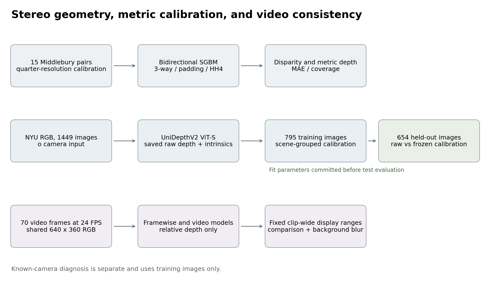
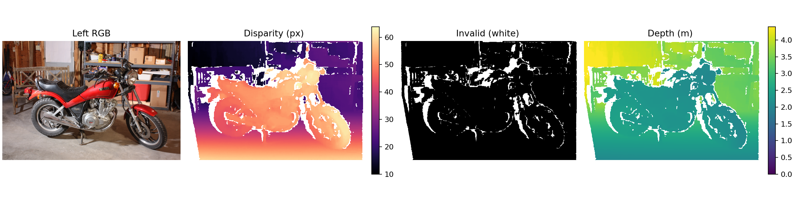
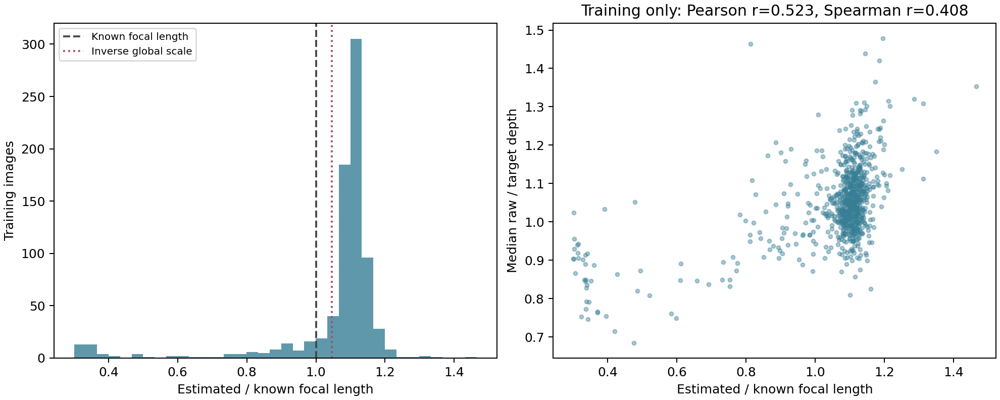
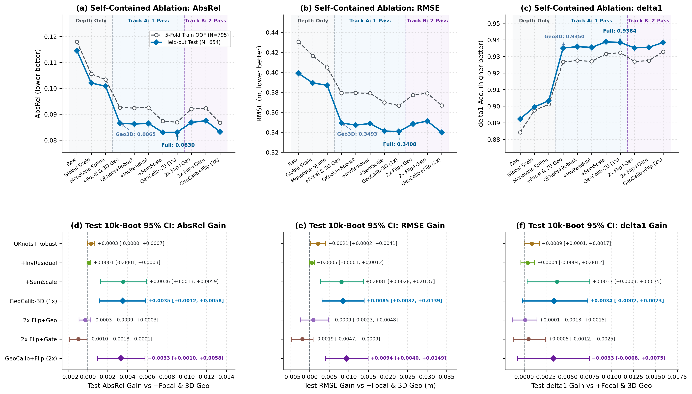
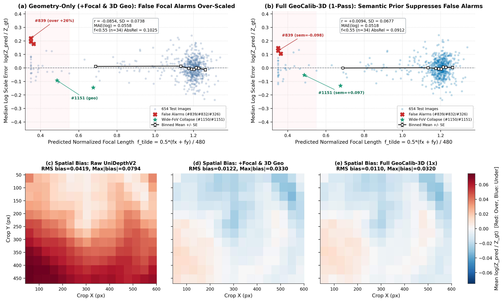

# Stereo Geometry, Monocular Metric Depth & GeoCalib-3D

Self-contained codebase, numerical evaluations, and 300-DPI figures for the **AIAA 3201 Computer Vision** depth estimation project spanning three coupled modules:

1. **Part 1 — Classical Stereo Reconstruction (Middlebury TrainingQ, 15 Pairs)**: Bidirectional Semi-Global Block Matching (`StereoSGBM`), reflection border padding vs unpadded ablations, left-right consistency filtering, region-wise (`nonoccluded` / `occluded`) diagnostics, and pinhole disparity-to-metric depth sensitivity.
2. **Part 2 — Monocular Metric Depth & Video Consistency (NYU Depth V2 + DAVIS)**: Zero-GT-intrinsics evaluation of frozen **UniDepthV2 ViT-S**, training-split camera-intrinsics sensitivity diagnosis (`N=795`), **Depth Anything V2 Small** vs **Video Depth Anything Small** 70-frame temporal consistency comparison, and depth-aware background blur rendering.
3. **Part 3 — `GeoCalib-3D` (Zero-GT-Intrinsics Post-Hoc Metric Calibration)**: Single-pass joint **inverse-depth monotone spline + predicted-focal / 3D geometry + Ridge-regularized internal ViT-S semantic prior + semantic-conditioned 2D spatial field**, trained strictly on the `795` official NYU training images (`249` scenes) with zero ground-truth intrinsics $K_{\text{true}}$ and verified once on the `654` held-out test images (`215` scenes).

Quick navigation: [Part 3 GeoCalib-3D Technical Report](docs/PART3_GEOCALIB.md) | [Reproduction Guide](docs/REPRODUCTION.md) | [Unified Manifest](results/manifest.json)



---

## Headline Results Across Parts 1–3

### Part 1: Middlebury Stereo Geometry (`results/part1_stereo/`)

Evaluated across all `15` rectified **Middlebury TrainingQ** pairs (`OpenCV 5.0.0`, 4 CPU threads, `1 px` explicit forward/backward left-right consistency check):

| Configuration | All-Pixel MAE (px) $\downarrow$ | Nonoccluded MAE (px) $\downarrow$ | Occluded MAE (px) | Valid Coverage $\uparrow$ | `< 1 px` Good Yield $\uparrow$ | Mean CPU Time / Pair |
| :--- | :---: | :---: | :---: | :---: | :---: | :---: |
| `reflect_3way` (Primary) | **1.3608** | 1.0508 | 9.1413 | 74.33% | 64.98% | **54.3 ms** (`0.0543 s`) |
| `reflect_hh4` (Full-8DP Ablation) | **1.2984** | **0.9716** | 9.5002 | **74.64%** | **66.04%** | 168.3 ms (`0.1683 s`) |
| `unpad_3way` (Unpadded Left Border) | 1.4188 | 1.0977 | 8.7557 | 62.20% | 54.35% | 47.3 ms (`0.0473 s`) |

- Reflection border padding (`reflect101` left-margin pad) recovers `+12.13 pp` valid pixel coverage (`62.20% -> 74.33%`) while simultaneously reducing all-pixel MAE (`1.4188 -> 1.3608 px`) and improving `< 1 px` accuracy (`54.35% -> 64.98%`).
- `reflect_hh4` improves nonoccluded accuracy further (`0.9716 px`, `+1.05 pp` `< 1 px` yield) at `3.1x` the CPU runtime of `reflect_3way`.
- Full tables & sensitivity numbers: [stereo_summary.csv](results/part1_stereo/stereo_summary.csv), [stereo_regions_summary.csv](results/part1_stereo/stereo_regions_summary.csv), [disparity_sensitivity.csv](results/part1_stereo/disparity_sensitivity.csv), and all 15 visual panels under [`results/figures/part1_stereo/`](results/figures/part1_stereo/Motorcycle.png).



---

### Part 2: Monocular Camera Diagnostic & Video Depth Consistency (`results/part2_depth_video/`)

- **Camera Intrinsics Sensitivity (`N=795` NYU Training Split Only)**:
  - **UniDepthV2 ViT-S** (RGB-only, unknown $K$): `AbsRel = 0.117945`, `RMSE = 0.430373 m`, `delta1 = 0.884173` (training median ratio `0.9561`).
  - **UniDepthV2 ViT-S** (with known ground-truth $K$): `AbsRel = 0.097094`, `RMSE = 0.396178 m`, `delta1 = 0.920460`.
  - Predicted normalized focal ratio correlates significantly with raw depth scale ratio (`Pearson r = 0.5231`, `p = 4.76e-57`; `Spearman r = 0.4085`, `p = 2.53e-33`; [camera_diagnostic.json](results/part2_depth_video/camera_diagnostic.json)).
- **Backbone Compute Profile (NVIDIA A40, [efficiency_summary.csv](results/part2_depth_video/efficiency_summary.csv))**:
  - **UniDepthV2 ViT-S** (`490x644`, internal FP16 autocast): `25.0 ms/img`, `498 MiB` peak allocated.
  - **Depth Anything V2 Small** (`518x924`, FP32): `58.1 ms/frame`, `375 MiB` peak allocated; `70`-frame mean adjacent disparity change `0.103695`.
  - **Video Depth Anything Small** (`518x924`, FP16 autocast): `61.8 ms/frame`, `2,689 MiB` peak allocated; `70`-frame mean adjacent disparity change `0.103065` (official `davis_rollercoaster.mp4` contains `70` frames total, so `--limit 100` processes all `70` frames; `depthlab.render_video` renders consistent foreground/background separation under [`results/figures/part2_video/`](results/figures/part2_video/video_frame_35.png) and packages `relative_depth_comparison.mp4` and `depth_aware_blur.mp4` into the git-ignored Canvas deliverable `outputs/delivery/depth_results.zip`).




---

### Part 3: `GeoCalib-3D` Held-Out 654-Image Benchmark (`results/part3_geocalib/`)

All methods below are evaluated over the identical RGB-only **UniDepthV2 ViT-S** prediction arrays (`480x640` RGB input -> `490x644` network resolution, official internal FP16 autocast) with zero ground-truth intrinsics $K_{\text{true}}$, `5`-fold / `4`-seed (`20261031, 42, 100, 20261121`) training-only selection (`795` images / `249` scenes), locked parameters (`test_read: false`, `frozen_geocalib_model.json` SHA-256 `816f799a...`), and one-shot held-out evaluation on `654` test images (`215` scenes). Part 3 end-to-end latencies (`43.04 / 46.93 / 92.78 ms/img`) and peak allocated VRAM (`raw`: `507.18 MiB`, `geocalib_3d` `float64` GPU post: `511.74 MiB`, `geocalib_3d_flip`: `521.73 MiB`) are uncontended measurements on an **NVIDIA GeForce RTX 4060 Laptop GPU** (distinct from Part 2's **NVIDIA A40** `25.0 ms/img` / `498 MiB` backbone profile):

| Method | Track (`Passes`) | Params (`Raw / Eff.DoF`) | Train OOF `AbsRel` | OOF `RMSE` (m) | OOF `delta1` | Test `AbsRel` $\downarrow$ | Test `RMSE` (m) $\downarrow$ | Test `delta1` $\uparrow$ | End-to-End RTX 4060 (`ms/img`) |
| :--- | :---: | :---: | :---: | :---: | :---: | :---: | :---: | :---: | :---: |
| `raw` (UniDepthV2 ViT-S) | 1-Pass (`1x`) | `0 / 0.0` | 0.117945 | 0.430373 | 0.884173 | 0.114540 | 0.398839 | 0.892293 | `43.04` |
| `global_scale` | 1-Pass (`1x`) | `1 / 1.0` | 0.105587 | 0.416395 | 0.897421 | 0.102033 | 0.389248 | 0.899513 | `—` |
| `monotone_spline` | 1-Pass (`1x`) | `6 / 6.0` | 0.103380 | 0.404847 | 0.901091 | 0.100827 | 0.386977 | 0.903253 | `65.02` (CPU post) |
| `geo_focal_3d` (Geometry-Only) | 1-Pass (`1x`) | `25 / 25.0` | 0.092502 | 0.379230 | 0.926687 | 0.086535 | 0.349250 | 0.935017 | `47.75` (CPU post) |
| `geosem_scale` (Semantic Scale) | 1-Pass (`1x`) | `1688 / 134.3` | 0.087323 | 0.369819 | 0.931481 | **0.082977** | 0.341153 | **0.938765** | `—` |
| **`geocalib_3d` (Primary)** | **1-Pass (`1x`)** | `5018 / 146.9` | **0.086894** | **0.366619** | **0.932284** | **0.083024** | **0.340792** | **0.938413** | **`46.93`** (`43.04 + 3.89`) |
| `geocalib_3d_flip` (Flip-TTA Track B) | 2-Pass (`2x`) | `5024 / 150.9` | 0.086697 | 0.366778 | 0.932848 | 0.083189 | **0.339846** | 0.938350 | `92.78` (`87.17 + 5.61`) |

- **10,000-Replicate Held-Out Scene-Cluster Bootstrap (`215` Scenes, [test_paired_bootstrap.csv](results/part3_geocalib/test_paired_bootstrap.csv))**:
  - **`geocalib_3d` vs `monotone_spline`**: `AbsRel +0.017803` (`95% CI [+0.013784, +0.022111]`, `p = 0.0`), `RMSE +0.046185 m` (`95% CI [+0.034878, +0.058758]`), `delta1 +3.52 pp` (`95% CI [+0.023056, +0.049139]`).
  - **`geocalib_3d` vs `geo_focal_3d`**: `AbsRel +0.003512` (`95% CI [+0.001204, +0.005810]`, `p = 0.0008`), `RMSE +0.008458 m` (`95% CI [+0.003151, +0.013915]`, `p = 0.0011`), `delta1 +0.34 pp` (`95% CI [-0.000169, +0.007285]`, `p = 0.0299`; meanwhile `geosem_scale` achieves `+0.37 pp` with `CI [+0.000340, +0.007501]`, `p = 0.0145`).
  - **2-Pass Flip-TTA Negative Finding**: `geocalib_3d_flip` (`2x` ViT-S passes, `92.78 ms/img`) is statistically indistinguishable from single-pass `geocalib_3d` (`46.93 ms/img`) on `AbsRel` (`-0.000166`, `p = 0.7086`) and `delta1` (`-0.000063`, `p = 0.5210`). Single-pass `geocalib_3d` strictly dominates the accuracy–latency Pareto frontier.
- **Mechanistic Resolution of Left-Tail Focal Bimodality**:
  - Without semantic disambiguation, predicted focal calibration over-scales close-range false focal alarms (`#839` kitchen counter: `geo_focal_3d` `AbsRel 0.2683 / delta1 0.5125 -> geocalib_3d 0.1699 / 0.9034`) while internal encoder features (`sem_shift = -0.098` on `#839` vs `+0.097` on wide-FoV `#1151`) suppress false alarms and boost genuine wide-FoV collapse (`#1151`: `0.0929 -> 0.0576`, `delta1 99.57%`).





---

## Repository Structure

```text
depthlab/                       Clean standalone package covering Parts 1, 2 & 3
  __init__.py, data.py, metrics.py, prepare.py, cache.py, cache_subset.py
  inference_backend.py, stereo.py, infer_nyu.py, infer_video.py, render_video.py, diagnose.py, verify.py
  geocalib_io.py, geocalib_cache.py, geocalib_diagnose.py, geocalib_model.py, geocalib_evaluate.py, geocalib_figures.py
docs/
  PART3_GEOCALIB.md             Full Part 3 technical report (oracles, 26-candidate CV, test evaluation, mechanism)
  REPRODUCTION.md               End-to-end environment, inputs, CLIs, and verification guide
results/
  manifest.json                 Unified SHA-256 integrity manifest across all delivered code, tables & figures
  part1_stereo/                 Middlebury 15-scene CSVs, region/sensitivity tables & runtime JSON
  part2_depth_video/            NYU camera diagnostic, A40 efficiency, and DAVIS video temporal CSVs/JSONs
  part3_geocalib/               Frozen GeoCalib-3D JSON, train-only OOF/diag tables, 654-test tables & CIs
  figures/                      Clean 300-DPI visual figures (pipeline, part1_stereo, part2_nyu, part2_video, part3_geocalib)
scripts/
  run_baselines.sh              End-to-end inference & stereo baseline runner
  run_evaluation.sh             Frozen SHA-256-verified held-out evaluation replay
  slurm_gpu.sh                  Optional SLURM GPU launcher
tests/                          Unit, regression & artifact integrity tests (incl. test_part3_geocalib.py)
data/, third_party/, outputs/   External datasets, upstream checkouts, and large array caches (git-ignored)
requirements-reproduction.txt   Pinned Python reproduction dependencies
requirements-linux-cu128.lock.txt
```

---

## Verification & Running

```bash
# Linux (from repository root)
python -m depthlab.verify --manifest results/manifest.json
python -m pytest -q
```

```powershell
# Windows (PowerShell, inside an activated Python environment; skips POSIX fcntl/bash & optional video-recovery tests)
python -m depthlab.verify --manifest results/manifest.json
python -m pytest -q --ignore=tests/test_video_recovery.py -k "not shell_defaults and not writer_crash_resume"
```

```bash
# Optional end-to-end baseline inference & frozen replay (requires local data/, third_party/, outputs/)
bash scripts/run_baselines.sh data third_party outputs results
bash scripts/run_evaluation.sh data outputs results/part3_geocalib
```

See [docs/REPRODUCTION.md](docs/REPRODUCTION.md) for dataset/weight setup, individual CLI entrypoints (`--help`), and programmatic inference usage.

---

## Sources and Licenses

- [Middlebury Stereo Evaluation](https://vision.middlebury.edu/stereo/submit3/), and Hirschmuller, *Stereo Processing by Semiglobal Matching and Mutual Information*, TPAMI 2008.
- [OpenCV StereoSGBM](https://docs.opencv.org/4.x/d2/d85/classcv_1_1StereoSGBM.html).
- [NYU Depth V2](https://cs.nyu.edu/~fergus/datasets/nyu_depth_v2.html), Silberman et al., ECCV 2012.
- [UniDepthV2](https://arxiv.org/abs/2502.20110) and [official repository](https://github.com/lpiccinelli-eth/UniDepth) (CC BY-NC 4.0).
- [Depth Anything V2](https://arxiv.org/abs/2406.09414) and [official repository](https://github.com/DepthAnything/Depth-Anything-V2) (Apache 2.0).
- [Video Depth Anything](https://arxiv.org/abs/2501.12375) and [official repository](https://github.com/DepthAnything/Video-Depth-Anything) (Apache 2.0).
