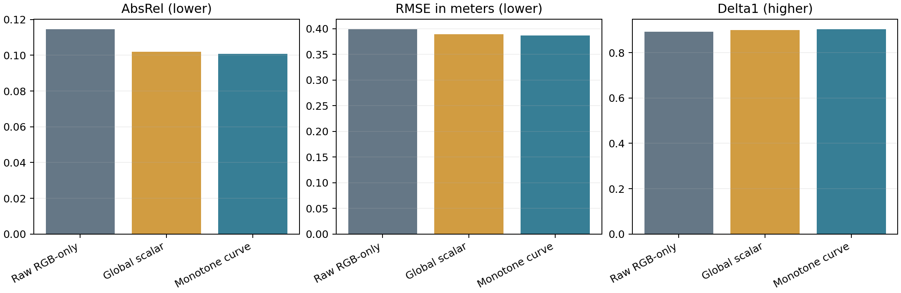
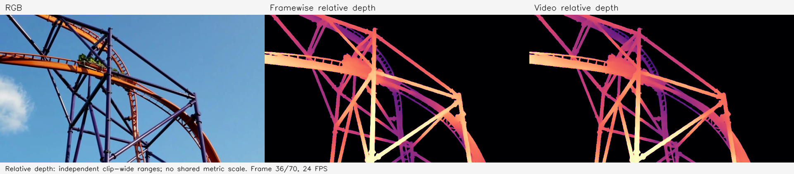
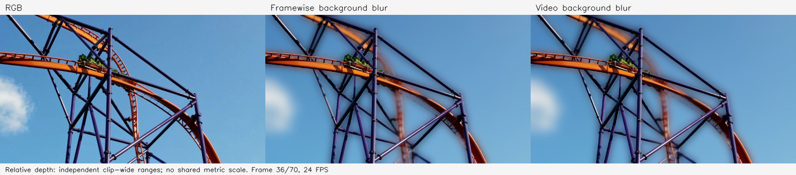
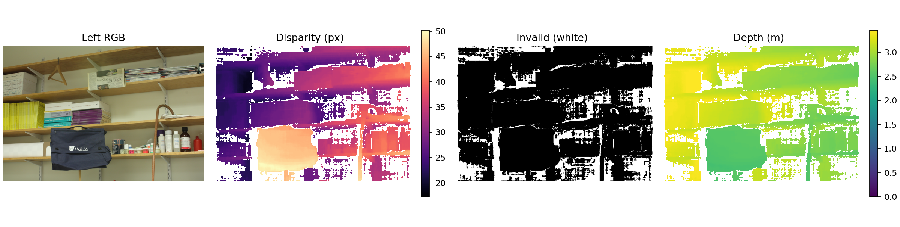
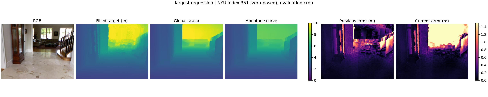
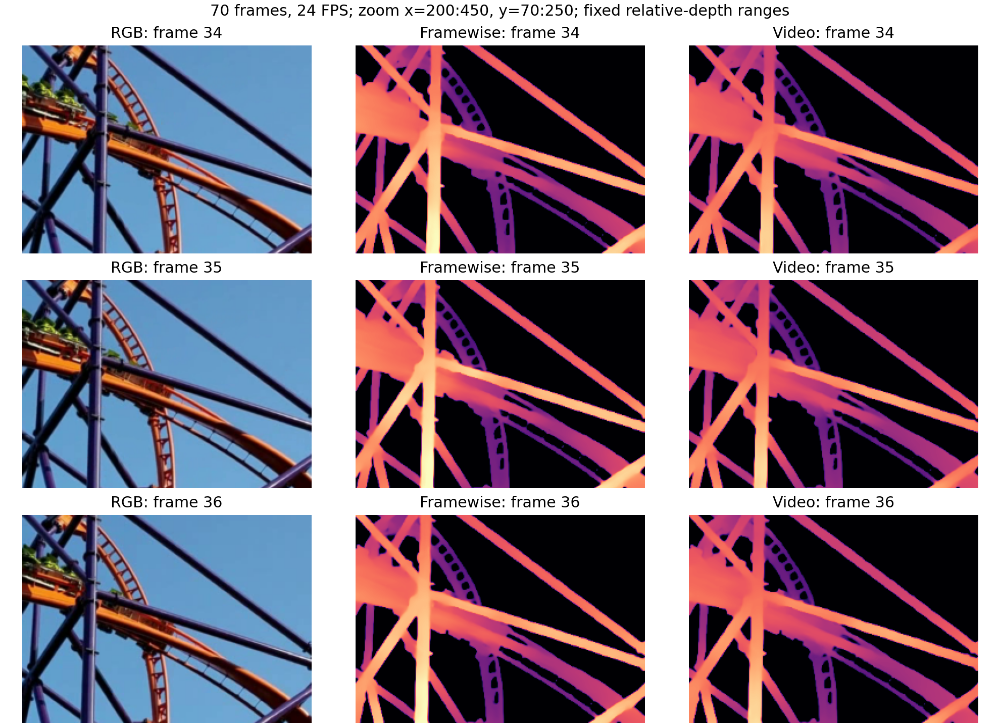

# Stereo and monocular depth

AIAA 3201 course project on stereo geometry, RGB-only metric depth, video depth consistency, and training-only depth calibration.

## Installation and data

Use Python 3.10 and a CUDA-capable GPU. Two environments preserve the upstream models' different PyTorch and NumPy versions:

```bash
git clone https://github.com/hhuang999/AIAA3102_CV_FINALPROJECTA.git
cd AIAA3102_CV_FINALPROJECTA
conda create -n depth-metric python=3.10 -y
conda create -n depth-video python=3.10 -y
conda run -n depth-metric pip install -r requirements-metric.txt
conda run -n depth-video pip install -r requirements-video.txt
```

Obtain the official code at these revisions:

| Repository | Revision |
|---|---|
| [UniDepth](https://github.com/lpiccinelli-eth/UniDepth) | `8d8cfe4c7ee15297099983607febf0d4f32eb3d6` |
| [Depth Anything V2](https://github.com/DepthAnything/Depth-Anything-V2) | `a561b849ebae10a6f5ef49e26c83cbbcd36c71bf` |
| [Video Depth Anything](https://github.com/DepthAnything/Video-Depth-Anything) | `4f5ae23172ba60fd7bc11ef671cca678842c7072` |

```bash
mkdir -p third_party
git clone https://github.com/lpiccinelli-eth/UniDepth.git third_party/UniDepth
git -C third_party/UniDepth checkout 8d8cfe4c7ee15297099983607febf0d4f32eb3d6
git clone https://github.com/DepthAnything/Depth-Anything-V2.git third_party/Depth-Anything-V2
git -C third_party/Depth-Anything-V2 checkout a561b849ebae10a6f5ef49e26c83cbbcd36c71bf
git clone https://github.com/DepthAnything/Video-Depth-Anything.git third_party/Video-Depth-Anything
git -C third_party/Video-Depth-Anything checkout 4f5ae23172ba60fd7bc11ef671cca678842c7072
```

Official GitHub source archives at these revisions are equivalent inputs. The inference commands import the source directly. UniDepth's optional KNN and patch-extraction training/3D-evaluation extensions are not used by this project's 2D depth evaluation. Video frames are decoded with OpenCV, shared by both video pipelines.

Place these downloads in `data/`:

- [Middlebury quarter-resolution input](https://vision.middlebury.edu/stereo/submit3/zip/MiddEval3-data-Q.zip) and [left ground truth](https://vision.middlebury.edu/stereo/submit3/zip/MiddEval3-GT0-Q.zip), retaining their original ZIP filenames.
- [NYU Depth V2 labeled data](https://horatio.cs.nyu.edu/mit/silberman/nyu_depth_v2/nyu_depth_v2_labeled.mat) and [official splits.mat](https://horatio.cs.nyu.edu/mit/silberman/indoor_seg_sup/splits.mat).
- `davis_rollercoaster.mp4` from Video Depth Anything's `assets/example_videos/` directory. The actual clip contains **70 frames at 24 FPS**; requesting the first 100 uses all 70, without repeating frames.

Download weights into the following directories:

| Directory under data/weights | Official files |
|---|---|
| `unidepth_v2_vits14/` | `config.json` and `model.safetensors` from [UniDepthV2 ViT-S](https://huggingface.co/lpiccinelli/unidepth-v2-vits14/tree/main) |
| `depth_anything_v2_small/` | `depth_anything_v2_vits.pth` from [Depth Anything V2 Small](https://huggingface.co/depth-anything/Depth-Anything-V2-Small/tree/main) |
| `video_depth_anything_small/` | `video_depth_anything_vits.pth` from [Video Depth Anything Small](https://huggingface.co/depth-anything/Video-Depth-Anything-Small/tree/main) |

The local UniDepth folder avoids requiring an online Hub connection during inference. Data, weights, third-party source, raw arrays, and videos are excluded from Git.

## Small trial

After preparing the downloads, run one stereo pair, two training images, and five shared video frames. The trial writes to separate output directories and does not evaluate test images:

```bash
conda run -n depth-metric python -m depthlab.prepare --data-root data --output outputs/trial/data.json
conda run -n depth-metric python -m depthlab.stereo --data-root data --output outputs/trial/stereo --limit 1
conda run -n depth-metric python -m depthlab.infer_nyu --data-root data --source third_party/UniDepth --weights data/weights/unidepth_v2_vits14 --output outputs/trial/nyu --split train --limit 2
conda run -n depth-video python -m depthlab.infer_video --method decode --video data/davis_rollercoaster.mp4 --output outputs/trial/frames --limit 5
conda run -n depth-video python -m depthlab.infer_video --method image --source third_party/Depth-Anything-V2 --weights data/weights/depth_anything_v2_small/depth_anything_v2_vits.pth --frames outputs/trial/frames --output outputs/trial/image
conda run -n depth-video python -m depthlab.infer_video --method video --source third_party/Video-Depth-Anything --weights data/weights/video_depth_anything_small/video_depth_anything_vits.pth --frames outputs/trial/frames --output outputs/trial/video
conda run -n depth-metric python -m depthlab.render_video --frames outputs/trial/frames --image-predictions outputs/trial/image --video-predictions outputs/trial/video --output outputs/trial/delivery --results outputs/trial/figures
conda run -n depth-metric python -m pytest -q
```

## Metric inference

```bash
conda run -n depth-metric python -m depthlab.prepare --data-root data
conda run -n depth-metric python -m depthlab.infer_nyu \
  --data-root data --source third_party/UniDepth \
  --weights data/weights/unidepth_v2_vits14 --output outputs/nyu_rgb
```

UniDepthV2 ViT-S receives RGB only and retains its official internal FP16 autocast and default resolution bounds. RGB input and returned depth are 480x640; the network input is recorded separately. Floating-point depth and estimated camera matrices are saved for all 1,449 images. This command does not calculate test metrics.

The NYU protocol uses filled `depths` in meters, MATLAB split indices minus one, and the Python crop `[45:471, 41:601]`. Targets satisfy `0.001 < depth < 10`; predictions are clipped to `[0.001, 10]`. AbsRel, RMSE and delta1 (`ratio < 1.25`) use float64 and equal per-image averaging, with no test-time scale alignment. Any necessary output resizing is bilinear with `align_corners=False`.

## Video and background blur

Decode once with `depthlab.infer_video --method decode`, then run `--method image` and `--method video` on the saved frames. Both methods receive the same 70 RGB frames resized to 640x360. Each preserves its official preprocessing with input size 518; the recorded network size is 518x924. The framewise Small model uses FP32; the video Small model uses its official offline FP16 path, including overlapping 32-frame windows and internal cross-window alignment. Their outputs are relative depth, with larger values nearer the camera.

`depthlab.render_video` uses each method's own whole-clip second and 98th percentiles, fixed across all frames, and the same magma palette. Colors do not represent a shared metric scale. The auxiliary mean adjacent-frame change contains real motion as well as flicker and is not a depth-accuracy measure.

The application preserves normalized values above 0.55 in focus. More distant pixels blend between six Gaussian blur levels, from sigma zero to nine pixels. Both depth methods use the same application settings. The comparison and application videos retain 70 frames at 24 FPS and are packed into `outputs/delivery/depth_results.zip`.

## Running baselines

Set the two Python paths, then run all baselines without calculating NYU test scores:

```bash
export METRIC_PYTHON="$(conda run -n depth-metric python -c 'import sys; print(sys.executable)')"
export VIDEO_PYTHON="$(conda run -n depth-video python -c 'import sys; print(sys.executable)')"
bash scripts/run_baselines.sh data third_party outputs results
```

On Slurm, submit the same command through `scripts/slurm_gpu.sh`, specifying your partition and QOS with `sbatch`. The wrapper uses the GPU UUID when a cluster exposes only one allocated device but supplies a physical CUDA index. It retains the scheduler mask when several devices are visible. Inference runtime excludes file IO; each runtime JSON describes its measured scope, precision, warmup, actual network size, peak allocated/reserved GPU memory, and hardware. Offline video time is amortized over the decoded frames, including overlap and alignment.

## Stereo geometry

Use the 15 Middlebury quarter-resolution training scenes, including `im0.png`, `im1.png`, `calib.txt`, and `disp0GT.pfm` under `MiddEval3/trainingQ/`.

```bash
python -m depthlab.stereo --data-root data --output results
python -m pytest
```

Three settings compare unpadded 3-way SGBM, reflected-padding 3-way SGBM, and reflected-padding HH4. Matching uses grayscale images, a five-pixel block, and a disparity range rounded up to a multiple of 16. Both directions use the same matcher and padding. Predicted disparities must be finite, positive, inside the original corresponding image, and agree within one pixel with the reverse prediction sampled at the nearest column. Padding supplies context without making out-of-image matches valid.

Disparity MAE is computed on the intersection of valid predictions and finite positive ground truth. Coverage divides that intersection by the ground-truth valid count. Scene scores are averaged equally. Depth uses quarter-resolution calibration, `focal * baseline_m / (disparity + doffs)`. Invalid depths are NaN.

## Training-only calibration

Calibration uses 795 training images grouped by the exact NYU scene name into five folds. Keeping a scene in one fold avoids learning from closely related views of the validation room. Sorted unique scene names are shuffled with NumPy seed 42 and split into equally sized scene groups. All fit quantities, including feature standardization, come only from the fitting folds.

The global scalar is the median of the per-image median target/prediction ratios over valid crop pixels. A six-parameter monotone curve replaces that scalar with a continuous piecewise-linear map in log depth. Its knots are 0.3, 0.7, 1.5, 3, 6 and 12 meters. The map is anchored at the first knot with a log offset bounded by plus/minus log(2); five slopes lie in [0.25, 2]. The nearest segment extrapolates outside the knot range.

Each fitting image contributes 4,096 randomly sampled valid pixels. Float64 L-BFGS with strong Wolfe line search runs for at most 80 iterations on smooth bounded parameters. The objective is mean per-image clipped-depth RMSE, normalized by its initial scalar value, plus 0.01 times mean squared adjacent-slope differences and 0.001 times mean squared slope deviations from one.

The residual model predicts an image-wise log scale from eight statistics of the original log-depth crop: five percentiles (10, 25, 50, 75, 90), mean, population standard deviation, and the average absolute horizontal/vertical neighbor difference. These features use all crop pixels, without a target mask. Its training target is the log median target/curve-output ratio. Ridge regression minimizes MSE + lambda times squared coefficient norm; the intercept is the target mean. Candidate lambda values are 0.1, 1, 10 and shrinkages are 0.5, 1. Predicted log scales are clipped to plus/minus 0.15 after shrinkage. Only log calculations use a 1e-6 floor; depth outputs are clipped to [0.001, 10].

A candidate is eligible only when all three metrics improve over the curve both overall and in every held-out training fold. The eligible candidate with lowest out-of-fold AbsRel is selected; otherwise the final method remains the curve. All candidates' out-of-fold results are retained. The scalar is one global scale; the curve and adaptive residual are extensions, not single global scalars.

The residual bound limits each image's correction to a small change around the global curve.

```bash
"$METRIC_PYTHON" -m depthlab.calibration --data-root data \
  --predictions outputs/nyu_rgb --output results
git add results/calibration_parameters.json
git commit -m "Save calibration fitted on training images"
bash scripts/run_evaluation.sh data third_party outputs results
```

The final command evaluates the 654 test images only after fitting and saving the parameters. Pairwise confidence intervals use 10,000 scene-cluster bootstrap draws, retaining image weighting within each replicate. Depth-bin scores average per-image metrics over images containing that bin. The failure-case rule averages metric gains normalized by the previous method's dataset-average scores, then selects the largest gain and largest regression without manual replacement.

The final command also performs a separate training-only camera diagnosis. It compares estimated/known focal ratios to median raw/target depth ratios and repeats inference on the 795 training images with the NYU toolbox RGB intrinsics. These known-camera predictions are kept separate from the RGB-only main results. The camera matrix uses the original 640x480 coordinates; the official inference API handles internal resizing.

## Results

<!-- results:start -->

### Stereo: equal-weight mean over 15 scenes

| configuration   |   mae_px |   valid_fraction |   cpu_seconds |
|:----------------|---------:|-----------------:|--------------:|
| reflect_3way    |   1.3409 |           0.7409 |        0.0631 |
| reflect_hh4     |   1.2899 |           0.7457 |        0.1766 |
| unpad_3way      |   1.4116 |           0.6207 |        0.0767 |

### NYU: 654 held-out images, RGB only

| method         |   abs_rel |   rmse |   delta1 |
|:---------------|----------:|-------:|---------:|
| raw            |    0.1145 | 0.3988 |   0.8923 |
| global_scale   |    0.1020 | 0.3893 |   0.8995 |
| monotone_curve |    0.1008 | 0.3870 |   0.9032 |

### Scene-grouped training out-of-fold scores

| method             |   abs_rel |   rmse |   delta1 |
|:-------------------|----------:|-------:|---------:|
| raw                |    0.1179 | 0.4304 |   0.8842 |
| global_scale       |    0.1050 | 0.4150 |   0.8978 |
| monotone_curve     |    0.1031 | 0.4037 |   0.9013 |
| residual_l0.1_s0.5 |    0.1019 | 0.3997 |   0.9051 |
| residual_l0.1_s1   |    0.1023 | 0.4001 |   0.9062 |
| residual_l1_s0.5   |    0.1020 | 0.4003 |   0.9042 |
| residual_l1_s1     |    0.1018 | 0.3992 |   0.9057 |
| residual_l10_s0.5  |    0.1027 | 0.4025 |   0.9021 |
| residual_l10_s1    |    0.1024 | 0.4015 |   0.9029 |

### Training-only camera diagnosis: 795 images

| method           |   abs_rel |   rmse |   delta1 |   training_median_scale |
|:-----------------|----------:|-------:|---------:|------------------------:|
| known_intrinsics |    0.0971 | 0.3962 |   0.9205 |                  0.9889 |
| rgb_only         |    0.1179 | 0.4304 |   0.8842 |                  0.9561 |

### Efficiency

| model                             | gpu        | precision                       | network_hw   |   seconds_per_image_or_frame |   peak_allocated_mib |   peak_reserved_mib |
|:----------------------------------|:-----------|:--------------------------------|:-------------|-----------------------------:|---------------------:|--------------------:|
| UniDepthV2 RGB-only               | NVIDIA A40 | official internal FP16 autocast | 490x644      |                       0.0250 |             498.0771 |            604.0000 |
| UniDepthV2 known camera, training | NVIDIA A40 | official internal FP16 autocast | 490x644      |                       0.0263 |             497.0161 |            624.0000 |
| Depth Anything V2 Small           | NVIDIA A40 | FP32                            | 518x924      |                       0.0581 |             375.3647 |            448.0000 |
| Video Depth Anything Small        | NVIDIA A40 | official FP16 autocast          | 518x924      |                       0.0618 |            2689.2197 |           3138.0000 |

Times use each model's reported inference scope; offline video time is amortized over the 70 decoded frames. Peak memory is allocated GPU memory; reserved memory is also retained in the CSV and runtime JSON files.

The final method is the monotone curve. No residual candidate passed all metrics in every fold. The residual stage is inactive; its recorded incremental runtime is zero.

### Video: mean adjacent normalized-depth change

| method    |   mean_adjacent_change |
|:----------|-----------------------:|
| framewise |               0.103695 |
| video     |               0.103065 |

<!-- results:end -->

The CSV/JSON tables under `results` contain per-scene, per-image, fold-level and aggregate scores. `python -m depthlab.summarize --outputs outputs --results results --readme README.md` regenerates the displayed tables from measured results. Raw arrays and MP4/ZIP exports remain under `outputs`.








## Analysis and limitations

Both the global scalar and monotone curve improve average test AbsRel, RMSE and delta1 over raw inference. The gains also appear in scene-held-out training predictions, although the test RMSE gain is smaller. This supports generalization to unseen NYU scenes, with a weaker effect than the training estimate. See [training/test gains](results/generalization_gains.csv). All residual candidates improve the overall out-of-fold scores, but each worsens AbsRel in fold zero; none is deployed. The complete [fold scores](results/calibration_oof_per_fold.csv) and [selection table](results/calibration_selection.csv) retain these rejected alternatives.

The [paired scene-bootstrap intervals](results/test_paired_intervals.csv) exclude zero for the curve's AbsRel and delta1 gains over the scalar. Its RMSE interval crosses zero. The scalar's delta1 interval against raw inference also crosses zero. Average gains therefore do not support an improvement in every metric with equal confidence. The [image-level change counts](results/test_change_counts.csv) show substantial groups of regressions at both stages.

The [depth-bin results](results/test_bins_summary.csv) explain part of this tradeoff. Relative to the scalar, the curve improves the near and far ranges but worsens all three metrics in the 2–4 meter bin. Raw inference remains better in the 6–10 meter range. The [bin image/pixel counts](results/test_bins_counts.csv) describe how much evidence each range contains. No method or setting was changed after examining these test results. [Postprocessing times](results/postprocessing_summary.csv) are CPU measurements with four BLAS/OpenMP threads; they are additional to GPU inference time.

In the training-only camera experiment, supplying known intrinsics improves all three raw metrics and moves the fitted global scale closer to one. Estimated focal ratios and raw/target depth ratios have a moderate positive association; the [correlation statistics](results/camera_diagnostic.json) and [scatter plot](results/figures/nyu/camera_diagnostic.png) support focal estimation as one contributor to scale bias. Shape and boundary errors remain, and the RGB-only main comparison never receives this camera information. The original-coordinate RGB intrinsics come from the [NYU toolbox](https://cs.nyu.edu/~fergus/datasets/toolbox_nyu_depth_v2.zip).

Three difficult cases illustrate different limitations. All NYU indices and video frame numbers below are zero-based; the video footer uses one-based playback numbers.

- **Stereo, Middlebury Shelves:** thin shelf supports, repeated book edges and low-texture walls leave large invalid regions. HH4 has greater coverage here but higher disparity error than reflected 3-way matching. More aggregation does not improve every scene. White pixels in the [scene visualization](results/figures/stereo/Shelves.png) mark rejected predictions.
- **Metric calibration, NYU index 351, foyer_0001:** the distant bright room is already underestimated after the scalar. The shared curve compresses its depth further and cannot recover missing boundary detail. This is the curve's largest regression under the fixed metric-gain rule; [all automatically selected cases](results/test_cases.csv) remain available.
- **Video, rollercoaster frames 34–36 and 68–69:** moving thin supports change thickness and merge at crossings. The carriage and people become a broad foreground blob in both methods. The video model slightly steadies broad color regions, while halos and moving-edge artifacts remain. At the end of the clip, the thin flagpole and distant foliage are poorly separated. [Adjacent-frame differences](results/figures/video/video_adjacent_frames.png) include real camera/subject motion, so they cannot isolate flicker.







The two video outputs are visually close on this short clip. The auxiliary adjacent-change averages are also close; neither establishes depth accuracy without ground truth. [Center-row time slices](results/figures/video/video_temporal_slices.png) preserve the common moving structure, with local edge variation in both models. Background blur inherits depth-boundary halos and blends foreground color into the background because it has no occlusion-aware layers. Useful next steps are boundary-aware compositing and calibration diagnostics on additional held-out scenes. The present experiment uses only the supplied data and does not establish generalization beyond indoor NYU images or long-video stability.

## Sources

- [Middlebury Stereo Evaluation](https://vision.middlebury.edu/stereo/submit3/).
- Hirschmüller, *Stereo Processing by Semiglobal Matching and Mutual Information*, TPAMI 2008.
- [OpenCV StereoSGBM](https://docs.opencv.org/4.x/d2/d85/classcv_1_1StereoSGBM.html).
- [NYU Depth V2](https://cs.nyu.edu/~fergus/datasets/nyu_depth_v2.html), Silberman et al., ECCV 2012.
- [UniDepthV2](https://arxiv.org/abs/2502.20110), Piccinelli et al., 2025; upstream source is CC BY-NC 4.0.
- [Depth Anything V2](https://arxiv.org/abs/2406.09414), Yang et al., NeurIPS 2024; Small source/weights are Apache 2.0.
- [Video Depth Anything](https://arxiv.org/abs/2501.12375), Chen et al., CVPR 2025; Small source/weights are Apache 2.0.

Downloaded third-party repositories retain their original license files. Data and model licenses continue to apply to downloads obtained from the linked sources.
