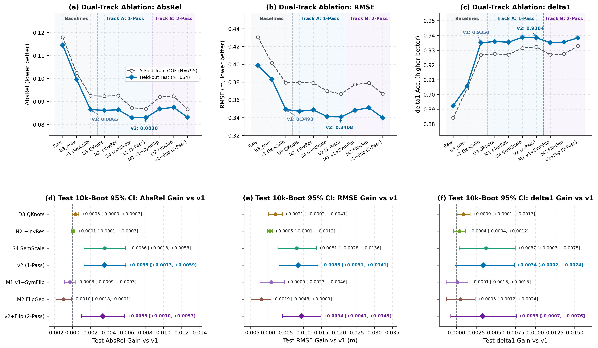
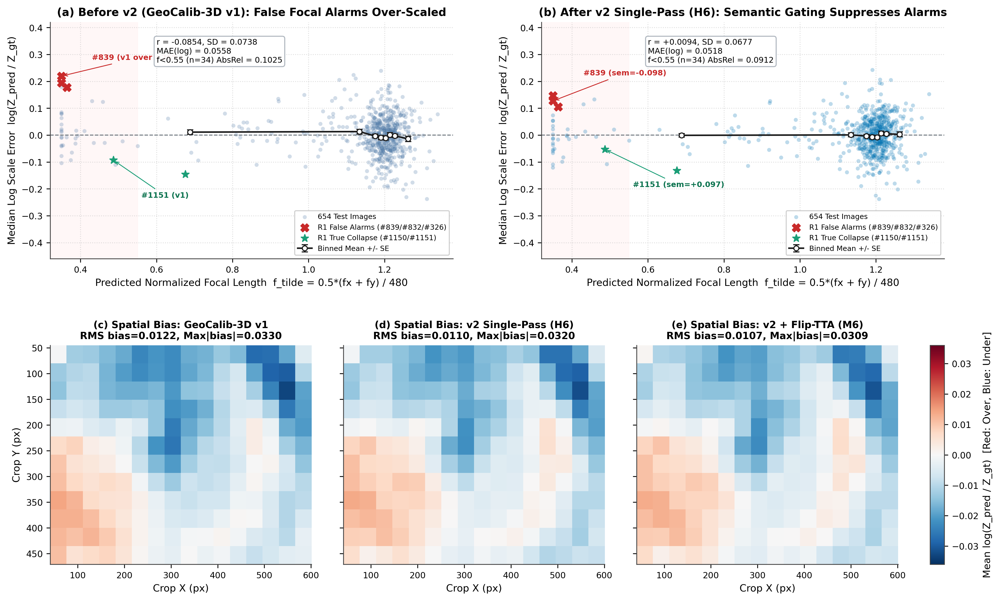

# Stereo and monocular depth

AIAA 3201 course project covering stereo geometry (Part 1), RGB-only metric depth and video depth consistency (Part 2), and zero-GT-intrinsics post-hoc metric depth calibration (Part 3B: restored baseline `b3_residual_v1`, Round 1 `GeoCalib-3D v1`, and Round 2 `GeoCalib-3D v2`).

Quick links: [Part 3B Overview](docs/PART3B_OVERVIEW.md) | [Round 1 Report (`GeoCalib-3D v1`)](docs/PART3B_SOTA.md) | [Round 2 Report (`GeoCalib-3D v2`)](docs/PART3B_SOTA_V2.md) | [Reproduction Guide](docs/REPRODUCTION.md)

## Part 3B headline results (`GeoCalib-3D v1` & `v2`)

Evaluated on **NYU Depth V2** (`654` held-out test images across `215` scenes; RGB-only frozen **UniDepthV2 ViT-S**, zero ground-truth intrinsics $K_{\text{true}}$). All rows below run on the identical local UniDepthV2 ViT-S prediction cache (`outputs/nyu_rgb/depth.npy`; the earlier NAS-backed cache replay for `b3_residual_v1` gave `0.099607 / 0.383124 / 0.905546`, max aggregate mean diff `1.26e-4`).

| Method | Track (`Passes`) | Params (`Raw / Eff.DoF`) | OOF `AbsRel` $\downarrow$ | OOF `RMSE` $\downarrow$ | OOF `delta1` $\uparrow$ | Test `AbsRel` $\downarrow$ | Test `RMSE` (m) $\downarrow$ | Test `delta1` $\uparrow$ | Test Gain vs `B3_prev` / `v1` | End-to-End GPU (`ms/img`) |
| :--- | :---: | :---: | :---: | :---: | :---: | :---: | :---: | :---: | :--- | :---: |
| `raw` (UniDepthV2 ViT-S) | 1-Pass (`1x`) | `0 / 0.0` | 0.117945 | 0.430373 | 0.884173 | 0.114540 | 0.398839 | 0.892293 | `—` | `43.04` |
| `b1_global_scale` | 1-Pass (`1x`) | `1 / 1.0` | 0.105587 | 0.416395 | 0.897421 | 0.102033 | 0.389248 | 0.899513 | `—` | `—` |
| `b2_monotone_curve` | 1-Pass (`1x`) | `6 / 6.0` | 0.103380 | 0.404847 | 0.901091 | 0.100827 | 0.386977 | 0.903253 | `—` | `—` |
| `b3_residual_v1` (Restored `codex/part3b` baseline) | 1-Pass (`1x`) | `15 / 15.0` | 0.102441 | 0.401714 | 0.904042 | 0.099601 | 0.383099 | 0.905671 | Baseline (`—`) | `85.22` (NumPy post) |
| **`GeoCalib-3D v1`** (Round 1, Track A) | 1-Pass (`1x`) | `25 / 25.0` | 0.092502 | 0.379230 | 0.926687 | **0.086535** | **0.349250** | **0.935017** | `+0.01307 / +0.03385 m / +2.93 pp` vs `B3_prev` | `51.34` (CPU post) |
| **`GeoCalib-3D v2`** (`H6_geosem_inv_spline`, Round 2 Track A Primary) | **1-Pass (`1x`)** | `5018 / 146.9` | **0.086894** | **0.366619** | **0.932284** | **0.083024** | **0.340792** | **0.938413** | **`+0.01658 / +0.04231 m / +3.27 pp` vs `B3_prev`**<br>**`+0.00351 / +0.00846 m / +0.34 pp` vs `v1`** | **`47.67`** |
| `GeoCalib-3D v2 + Flip` (`M6_flip_inv_geosem`, Round 2 Track B Extension) | 2-Pass (`2x`) | `5024 / 150.9` | 0.086697 | 0.366778 | 0.932848 | 0.083189 | 0.339846 | 0.938350 | Statistically tied with 1-Pass `v2` on `AbsRel`/`delta1` (`p > 0.5`) at ~2x latency | `93.86` |

- **Zero $K_{\text{true}}$ & Strict Train/Test Protocol**: Calibration uses only UniDepthV2 RGB-only outputs and internal single-pass representations. All candidate development and 5-fold / 4-seed (`20261031, 42, 100, 20261121`) scene-grouped CV ran solely on the `795` official training images (`249` scenes), followed by parameter freeze (`8560b5a` for `v1`, `ebad14a` for `v2`) and a strictly one-shot evaluation on the `654` held-out test images (`215` scenes).
- **Honest Provenance Distinction**: Round 1 (`GeoCalib-3D v1`) had zero prior exposure to `splits["test"]`. Round 2 (`GeoCalib-3D v2`) was motivated by Round 1's documented post-test failure taxonomy (`#839 / #832 / #326` false focal alarms vs `#1150 / #1151` wide-FoV collapse), with 100% of Round 2 diagnosis, CV selection, and full-795 fitting isolated to the training split (`splits["test"]` access hard-blocked via `VerifiedV2Cache(allowed_split="train")`).
- **Paired Scene-Cluster Bootstrap (`10,000` replicates, `215` test scenes)**:
  - `v2` vs `B3_prev`: `AbsRel` `+0.016577` (`95% CI [+0.012706, +0.020809]`), `RMSE` `+0.042307 m`, `delta1` `+3.27 pp`.
  - `v2` vs `v1`: `AbsRel` `+0.003512` (`95% CI [+0.001280, +0.005868]`), `RMSE` `+0.008458 m` (`95% CI [+0.003117, +0.014054 m]`), `delta1` `+0.34 pp` (`95% CI [-0.000183, +0.007364]`).
- **Round 1 Failure Recovery (`v2` vs `v1`)**: `#839` (`kitchen_0039`: `AbsRel 0.2683 -> 0.1699`, `delta1 51.3% -> 90.3%`), `#832` (`kitchen_0038`: `0.2460 -> 0.1906`), `#326` (`classroom_0023`: `0.2168 -> 0.1481`), while further improving wide-FoV `#1151` (`0.0929 -> 0.0576`, `delta1 99.6%`).





## Verified Part 1, Part 2 & historical baseline restoration

Fresh executions in the pinned Linux reproduction environment were compared with the original frozen `codex/part3b` baseline results:

| Component | Verification |
|---|---|
| Part 1 | All 15 scenes, three stereo configurations and 135 saved arrays match the original byte-for-byte. |
| Part 2: NYU | All 1,449 newly inferred raw depth maps match the original element-for-element. |
| Part 2: video depth | Both methods' 70-frame raw depth streams match the original element-for-element. |
| Part 3B (`b3_residual_v1`) | All 654 final residual-corrected depth maps match; 2,616 per-image metric rows differ by at most 4.45e-16 after CSV round trips (`0.099607 / 0.383124 / 0.905546`). |
| Code and environment | 174 tests, 15 CLI entrypoints, shell syntax and 87 installed package dependencies passed. |

[Final code review](docs/FINAL_CODE_REVIEW_20261113.md), [current validation](results/final_review_20261113/validation.json), [complete restoration evidence](results/restoration_20261113/), and [unchanged historical artifacts](results/frozen_20261111/IMPORT_MANIFEST.json) retain the restoration details. The [frozen residual model](results/frozen_20261111/part3b_residual_20261111/final/frozen_model.json) (`b3_residual_v1`) remains untouched as the reference baseline, while [Round 1 frozen model](results/part3b_sota/frozen_sota_model.json) and [Round 2 frozen model](results/part3b_sota_v2/frozen_sota_v2_model.json) store the locked `GeoCalib-3D v1` and `v2` parameters.

## Layout

```text
depthlab/                       Core Part 1/2/3B modules + Round 1 (sota_*.py) & Round 2 (sota_v2_*.py)
docs/PART3B_OVERVIEW.md         Part 3B index comparing baseline, GeoCalib-3D v1 and GeoCalib-3D v2
docs/PART3B_SOTA.md             Full Round 1 report (GeoCalib-3D v1)
docs/PART3B_SOTA_V2.md          Full Round 2 report (GeoCalib-3D v2)
docs/REPRODUCTION.md            Reproduction instructions for baselines, v1 and v2
docs/FINAL_CODE_REVIEW_20261113.md / docs/FINAL_ACCEPTANCE_20261113.md
results/part3b_sota/            Round 1 frozen model, OOF/test tables & 31-file manifest
results/part3b_sota_v2/         Round 2 frozen model, OOF/test tables & 32-file manifest
results/figures/part3b_sota/    Round 1 300-DPI CVPR figures (fig1..fig5)
results/figures/part3b_sota_v2/ Round 2 300-DPI CVPR figures (fig1..fig5)
results/frozen_20261111/        Original frozen B3 parameters and historical evidence
results/restoration_20261113/   Original complete restoration evidence
results/final_review_20261113/  Immutable 2026-11-13 baseline review snapshot (codex/part3b)
scripts/                        Baseline and frozen-replay shell entrypoints
tests/                          Unit and numerical regression tests (incl. test_part3b_sota*.py)
data/                           External datasets and weights (ignored)
third_party/                    Pinned upstream Git checkouts (ignored)
outputs/                        Raw arrays and runtime artifacts (ignored)
requirements-reproduction.txt   Current reproduction environment entrypoint
```

Root-level legacy CSV/JSON files, `results/summary.md`, and `results/figures/{nyu,stereo,video}` describe the earlier seed-42 rewrite ([original repository commit](https://github.com/hhuang999/AIAA3201_CV_FINALPROJECT/blob/411687c4cce2a0c8be021f188c7ae9ef6b85de56/README.md)) and remain historical evidence.

## Verification & running

### Verify Part 3B Round 1 & Round 2 manifests and run tests

```bash
# Linux
python -m depthlab.verify --manifest results/part3b_sota/manifest.json
python -m depthlab.verify --manifest results/part3b_sota_v2/manifest.json
python -m pytest -q
```

```powershell
# Windows
D:\anaconda\envs\vb\python.exe -m depthlab.verify --manifest results/part3b_sota/manifest.json
D:\anaconda\envs\vb\python.exe -m depthlab.verify --manifest results/part3b_sota_v2/manifest.json
D:\anaconda\envs\vb\python.exe -m pytest -q --ignore=tests/test_video_recovery.py -k "not shell_defaults and not writer_crash_resume"
```

> **Manifest Lineage Note**: `results/part3b_sota/manifest.json` (`31` files) and `results/part3b_sota_v2/manifest.json` (`32` files) verify cleanly on this branch. Historical `results/final_review_20261113/manifest.json` (`336` files) is the immutable `2026-11-13` snapshot anchored on branch `codex/part3b` (`923ec49`); on `feat/part3b-sota-v2`, all `334` code, test, frozen-model, and historical-result files in that snapshot remain byte-identical, with only `README.md` and `docs/REPRODUCTION.md` updated to document `GeoCalib-3D v1` and `v2`.

### Run Part 1, Part 2 & baseline pipelines

Use Linux and Python 3.10 with [requirements-reproduction.txt](requirements-reproduction.txt) (or Windows Conda `vb` for verification/evaluation) and prepare data, weights and upstream sources per [docs/REPRODUCTION.md](docs/REPRODUCTION.md):

```bash
git clone --branch feat/part3b-sota-v2 https://github.com/hhuang999/AIAA3201_CV_FINALPROJECT.git
cd AIAA3201_CV_FINALPROJECT
export METRIC_PYTHON=/path/to/reproduction/python
export VIDEO_PYTHON="$METRIC_PYTHON"
"$METRIC_PYTHON" -m depthlab.verify --manifest results/part3b_sota_v2/manifest.json
"$METRIC_PYTHON" -m pytest -q
bash scripts/run_baselines.sh data third_party outputs/reproduction results/reproduction
bash scripts/run_evaluation.sh data outputs/reproduction results/reproduction
```

See [docs/REPRODUCTION.md](docs/REPRODUCTION.md) for the `depthlab.sota_v2_cache`, `depthlab.sota_evaluate`, and `depthlab.sota_v2_evaluate` entrypoints. Large raw arrays (`outputs/nyu_rgb/`, `outputs/nyu_rgb_aux/`, `outputs/nyu_rgb_flip/`) are kept out of Git with checksum-bound manifests.

## Sources and licenses

- [Middlebury Stereo Evaluation](https://vision.middlebury.edu/stereo/submit3/), and Hirschmueller, *Stereo Processing by Semiglobal Matching and Mutual Information*, TPAMI 2008.
- [OpenCV StereoSGBM](https://docs.opencv.org/4.x/d2/d85/classcv_1_1StereoSGBM.html).
- [NYU Depth V2](https://cs.nyu.edu/~fergus/datasets/nyu_depth_v2.html), Silberman et al., ECCV 2012.
- [UniDepthV2](https://arxiv.org/abs/2502.20110) and [official source](https://github.com/lpiccinelli-eth/UniDepth); source is CC BY-NC 4.0.
- [Depth Anything V2](https://arxiv.org/abs/2406.09414) and [official source](https://github.com/DepthAnything/Depth-Anything-V2); Small source/weights are Apache 2.0.
- [Video Depth Anything](https://arxiv.org/abs/2501.12375) and [official source](https://github.com/DepthAnything/Video-Depth-Anything); Small source/weights are Apache 2.0.

Downloaded repositories retain their original license files. Data and model licenses continue to apply to the external inputs.
